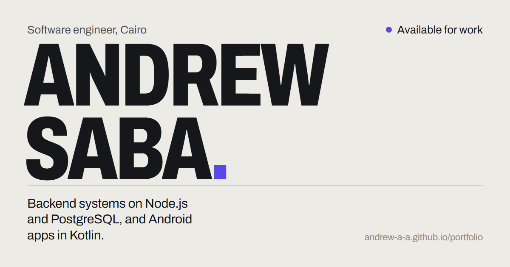

# Andrew Saba — Portfolio

My personal site: who I am, where I work, and the apps and tools I've built.

**Live:** https://andrew-a-a.github.io/portfolio/



## What's on it

- **Experience**: Nabd Suite, Tamayoz and the Payroll Engine at RAPTORS Tech, each row expands into the details.
- **Projects**: Mockation, ClipMix, CRUX, Geofenced Notes, Logo Adder, IFix, Binge Better, Content Guard and Location Reminder, with screenshots taken from the running apps.
- **Open source**: contributions to openGym and Payroll Engine, plus mtxpg and cds-test-architect.
- **About** and a **contact** footer with a copy-email button and a downloadable CV.

## How it's built

Plain HTML, CSS and JavaScript. No framework and no build step.

- Type is a single variable font, [Archivo](https://fonts.google.com/specimen/Archivo), using its width axis for the condensed headings.
- [Lenis](https://github.com/darkroomengineering/lenis) handles smooth scrolling, loaded from a CDN.
- One intro reveal on load, a statement that lights up word by word as you scroll, rows that expand in place, and a screenshot that follows the cursor over project rows on desktop.
- Visitors who ask their device to reduce motion get a static version.
- Responsive from 320px phones to wide desktops.
- Open Graph and Twitter tags give shared links a preview card.

## Run it locally

Any static server works. For example:

```bash
npx http-server -p 5173 -c-1
```

Then open http://localhost:5173.

## Layout

```
index.html        All page content
styles.css        Design tokens, layout and motion
script.js         Smooth scroll, reveals, expandable rows, cursor preview
assets/shots/     App screenshots (WebP)
assets/og.png     Link preview image
```

## Versions

- **v2.0**: the current design, large condensed type on a light background.
- **v1.0**: the original dark, terminal-style design. See the [releases](https://github.com/Andrew-A-A/portfolio/releases).

## Contact

andrew.adel.a@outlook.com · [LinkedIn](https://www.linkedin.com/in/andrew-adela/) · [GitHub](https://github.com/Andrew-A-A)
